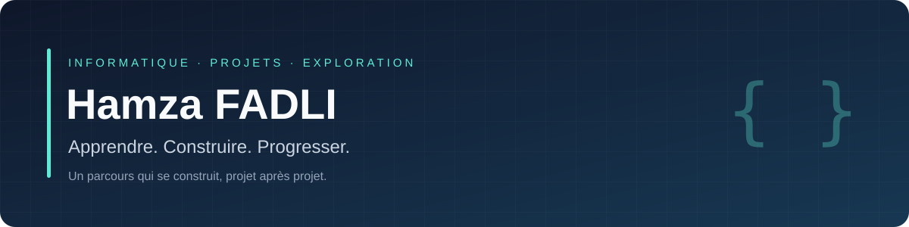

  

  <strong>Étudiant en L2 informatique · Développement · Algorithmique</strong>

  Des idées à explorer. Des projets à construire. Des compétences à approfondir.

---

### À propos

Je m’appelle **Hamza FADLI**, étudiant en deuxième année de licence informatique. J’aime comprendre comment les programmes fonctionnent et transformer ce que j’apprends en réalisations concrètes.

Je construis progressivement mon parcours autour de la programmation, de la résolution de problèmes et du développement d’applications. Ce GitHub rassemble mes projets personnels et les étapes de mon apprentissage ; il évoluera avec les sujets que j’explorerai.

### Ce que je développe

| Fondamentaux | Pratique | Méthode |
| :--- | :--- | :--- |
| Programmation en C et algorithmique | Applications interactives et interfaces graphiques | Décomposer un problème en étapes |
| Structures de données et logique | Projets personnels pour mettre les cours en pratique | Tester, corriger et améliorer le code |
| Organisation du code en fonctions | Découverte progressive de nouveaux outils | Documenter les choix et les fonctionnalités |

### Premières réalisations

Quelques projets personnels pour pratiquer la programmation en C et la création de pages web interactives.

| Projet | Présentation | Notions travaillées |
| :--- | :--- | :--- |
| [Mon espace étudiant](https://7amzvv.github.io/tableau-etudiant/accueil.html) | Petit tableau de bord pour ajouter des tâches et suivre les échéances. | Pages HTML, formulaires, CSS responsive et sauvegarde locale en JavaScript. |
| [Snake](https://github.com/7amzvv/snake-c) | Jeu au clavier avec score et historique de la session. | Boucle de jeu, déplacements, collisions et tableaux. |
| [Memory](https://github.com/7amzvv/memory-c) | Jeu de paires colorées avec 8, 16 ou 32 cartes. | Mélange aléatoire, gestion des états, interface et tests. |

Le code source du tableau de bord se trouve dans le dépôt [tableau-etudiant](https://github.com/7amzvv/tableau-etudiant).

### La suite

Mon objectif est de consolider mes bases pour poursuivre en **L3 informatique**, puis d’aborder des projets plus variés : outils utiles au quotidien, applications de gestion et exploration de nouveaux domaines du développement.

Les prochains projets viendront enrichir ce profil au fil de leur réalisation.

---

Hamza FADLI · Apprendre avec curiosité, avancer avec régularité.

